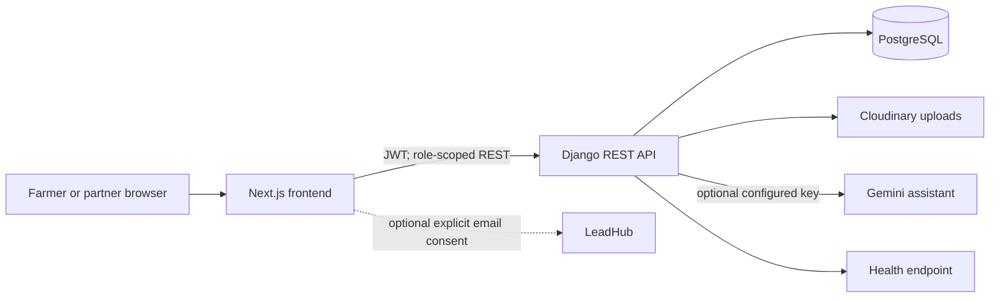

# KisanSetu architecture

## Current boundaries

- `frontend/` owns the bilingual user experience and calls `/api` through the configured API URL.
- `backend/` owns authentication, role checks, validation, and domain services. Farmer records are scoped to the authenticated farmer; bank access to private farmer records is intentionally denied.
- PostgreSQL is the hosted relational database; local Django development may use SQLite settings.
- Cloudinary stores uploaded media when configured. Account export lists file paths; it does not copy file contents.
- Gemini is optional. The assistant's answers are guidance, not an official scheme, health, or credit determination.
- LeadHub is an optional research signup channel; it requires an HTTPS origin and explicit opt-in, and does not replace product authentication.

## ADR-001: no lender sharing without farmer-scoped consent

**Decision:** Keep bank-role visibility of private farmer data disabled. Continue role-scoped public scheme and marketplace discovery.

**Reason:** There is no verified per-institution consent, field-level scope, expiry, revocation receipt, or data-access audit flow yet. A role name is not authorization from an individual farmer.

**Trade-off:** A lender cannot use the app for farmer-level analytics. Any future sharing needs reviewed consent, purpose limitation, revocation, and tests before activation.

## ADR-002: scheme suggestions are discovery aids only

The current scheme catalog contains free-text eligibility criteria; no official rules engine is present. Local recommendations now use crop-name text discovery only, omit numeric match/eligibility scores, and show a bilingual disclaimer. They do not use demo trust/loan scores or determine eligibility.
